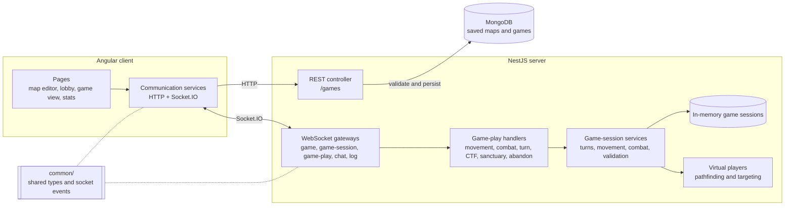

# Brick by Brick

Brick by Brick is a tactical role-playing web platform developed as part of the LOG2995 course. The project combines a drag-and-drop map editor, multiplayer session management, real-time communication, and turn-based combat into a complete gaming experience playable directly in the browser.

The goal of the project was to go beyond a simple prototype and deliver a complete gameplay loop: create a map, create or join a game session, coordinate players in a lobby, and then play together on a shared map with real-time updates.

## What Makes This Project Stand Out

- A full-stack web application built with a modern Angular frontend and a TypeScript backend.
- A complete tactical gameplay flow including map editing, lobby management, player coordination, and in-game actions.
- Real-time features such as chat, game state synchronization, and multiplayer interactions powered by Socket.IO.
- A well-structured backend with API documentation, data validation, and game session management.
- A quality-focused codebase with unit testing, coverage reports, linting, and continuous integration.

## Project Highlights

- Administration and editing views for creating and managing game content.
- Tile and object placement tools for building playable maps.
- Multiplayer game creation, lobby management, and player joining workflow.
- Game interface displaying map information, player information, countdown timer, chat messages, action buttons, end-turn controls, and surrender functionality.
- Turn-based combat system featuring movement, reachable tiles, player actions, and turn transitions.
- Support for virtual players, locked game sessions, and complete game progression.

## Technology Stack

- **Frontend:** Angular, Angular Material, TypeScript
- **Backend:** NestJS, TypeScript, Socket.IO
- **Data & Validation:** MongoDB, class-validator, class-transformer
- **Testing:** Jasmine (frontend), Jest (NestJS backend)
- **Tools:** ESLint, Prettier, npm, Swagger/OpenAPI for API documentation

## Repository Structure

- [client](./client) - Angular single-page application
- [server](./server) - Backend API and real-time game logic
- [common](./common) - Shared models, constants, and utilities
- [static](./static) - Static assets and supporting resources

## Getting Started

Install the dependencies from the repository root, then for each subproject:

```bash
npm ci
cd client && npm ci
cd ../server && npm ci
```

Start the applications locally:

```bash
cd client
npm start
```

```bash
cd server
npm start
```

By default, the client runs on port **4200** and the server on port **3000**.

## Architecture



- **Authoritative server.** Every action (move, attack, end turn, flag transfer) is a Socket.IO event validated server-side before the new state is broadcast to all players in the session.
- **Session state lives in memory** (one `GameSession` per match), while saved maps are persisted in MongoDB and checked with `class-validator` and custom map-validation rules.
- **Handlers per mechanic.** The game-play gateway delegates to small handlers (movement, combat, turn, capture-the-flag, sanctuary, abandon), which keeps each rule testable on its own.
- **Virtual players** use the same movement and combat services as humans. Pathfinding and targeting are separate services, so bot behaviour can change without touching the game rules.
- **Shared contracts.** `common/` holds the types and event names used by both the client and the server, so the two sides cannot drift apart.
- **CI.** The GitLab pipeline installs, lints and tests the project, then deploys the client and server on demand.

## Quality Assurance

Run these commands regularly during development:

```bash
cd client && npm run lint
cd client && npm run test
cd client && npm run coverage
```

```bash
cd server && npm run lint
cd server && npm run test
cd server && npm run coverage
```

## Documentation

- [CONTRIBUTING.md](./CONTRIBUTING.md) - Collaboration guidelines and Git workflow
- [DEPLOYMENT.md](./DEPLOYMENT.md) - Deployment instructions
- [TESTS.md](./TESTS.md) - Testing and code coverage details

## Why This Project Matters

This repository represents more than a university assignment. It demonstrates the ability to design and deliver a real-time multiplayer application, coordinate a shared game state between the frontend and backend, and maintain high software quality through testing and continuous integration. For recruiters, it showcases experience across product thinking, frontend architecture, backend engineering, and collaborative software development, all brought together in a cohesive full-stack project.
